# Accounting Engine Design – SVE 2.0
**Standard**: Integer-Safe Double-Entry Accounting  
**Precision**: Integer Paise (1 INR = 100 Paise)  
**Fundamental Law**: `TOTAL DEBITS == TOTAL CREDITS` for every posted entry  

---

## 1. Core Principles

1. **Integer Representation**:
   - Every financial value stored in the database is an integer in paise.
   - Example: ₹1,500.50 is stored as `150050`.
   - Never use JavaScript floating point arithmetic for balance storage.
2. **Double-Entry Equilibrium**:
   - Every economic event creates at least one debit line and one credit line.
   - A journal entry is valid only if:
     $$\sum \text{Debits} - \sum \text{Credits} = 0$$
3. **Immutability & Traceable Adjustments**:
   - Once posted, a journal entry is never silently edited or dropped.
   - Errors are corrected via reversal entries or traceable adjustment entries.
4. **Scope Isolation**:
   - Entries belong to a designated financial scope (`BUSINESS`, `PERSONAL`, `FAMILY`).
   - Inter-scope transactions (such as Business Drawings to Personal Bank) are balanced via Equity/Drawings clearing accounts.

---

## 2. Standard Chart of Accounts (COA) Structure

```mermaid
graph TD
    Root[Chart of Accounts] --> Assets[1000 - ASSETS]
    Root --> Liabilities[2000 - LIABILITIES]
    Root --> Equity[3000 - EQUITY]
    Root --> Revenue[4000 - REVENUE]
    Root --> Expenses[5000 - EXPENSES]

    Assets --> A1[1100 Cash in Hand]
    Assets --> A2[1200 Bank Accounts]
    Assets --> A3[1300 Customer Receivables]
    Assets --> A4[1400 Chit Receivables / Investment]
    Assets --> A5[1500 Prepaid Insurance]

    Liabilities --> L1[2100 Dealer Payables]
    Liabilities --> L2[2200 Bank Loans / Borrowings]
    Liabilities --> L3[2300 Vehicle / Personal Loans]
    Liabilities --> L4[2400 Chit Payables / Liabilities]

    Equity --> E1[3100 Owner Capital]
    Equity --> E2[3200 Owner Drawings]
    Equity --> E3[3300 Retained Earnings]

    Revenue --> R1[4100 Spare Parts Sales]
    Revenue --> R2[4200 Personal Salary Income]
    Revenue --> R3[4300 Rental Income]
    Revenue --> R4[4400 Chit Dividends / Profits]

    Expenses --> X1[5100 Cost of Goods / Purchases]
    Expenses --> X2[5200 Shop Operating Expenses]
    Expenses --> X3[5300 Employee Salaries]
    Expenses --> X4[5400 Insurance Expense]
    Expenses --> X5[5500 Loan Interest Expense]
    Expenses --> X6[5600 Personal Daily & Household Expenses]
```

---

## 3. Transaction Posting Matrix

| Event | Debit (Dr) | Credit (Cr) | Scope |
|---|---|---|---|
| **Customer Payment Received** | Cash / Bank Account (Asset ↑) | Customer Receivable (Asset ↓) | BUSINESS |
| **Credit Sale to Customer** | Customer Receivable (Asset ↑) | Sales Revenue (Revenue ↑) | BUSINESS |
| **Supplier Bill Added** | Purchase Expense / Inventory (Expense ↑) | Dealer Payable (Liability ↑) | BUSINESS |
| **Supplier Payment Made** | Dealer Payable (Liability ↓) | Cash / Bank Account (Asset ↓) | BUSINESS |
| **Insurance Premium Paid** | Insurance Expense (Expense ↑) | Bank Account (Asset ↓) | BUSINESS / PERSONAL |
| **Loan EMI Payment** | Loan Principal (Liability ↓) Loan Interest (Expense ↑) | Bank Account (Asset ↓) | BUSINESS / PERSONAL |
| **Chit Contribution Paid** | Chit Investment (Asset ↑) | Bank Account (Asset ↓) | PERSONAL / FAMILY |
| **Chit Auction Payout Received** | Bank Account (Asset ↑) | Chit Liability (Liability ↑) Chit Dividend / Cost (Expense/Income) | PERSONAL / FAMILY |
| **Personal Daily Expense** | Household Expense (Expense ↑) | Personal Cash / Bank (Asset ↓) | PERSONAL / FAMILY |
| **Business Drawing to Personal** | Owner Drawings (Equity ↓ in Business) Personal Bank (Asset ↑ in Personal) | Business Bank (Asset ↓ in Business) Capital Introduction (Equity ↑ in Personal) | BUSINESS & PERSONAL |

---

## 4. Financial Statements Derived from the Engine

1. **Balance Sheet**:
   $$\text{Assets} = \text{Liabilities} + \text{Equity}$$
2. **Profit and Loss Statement (P&L)**:
   $$\text{Net Profit} = \sum \text{Revenues} - \sum \text{Expenses}$$
3. **Cash Flow Statement**:
   $$\text{Net Cash Change} = \Delta \text{Operating} + \Delta \text{Investing} + \Delta \text{Financing}$$
4. **Personal Net Worth Statement**:
   $$\text{Personal Net Worth} = \sum \text{Personal Assets} - \sum \text{Personal Liabilities}$$
