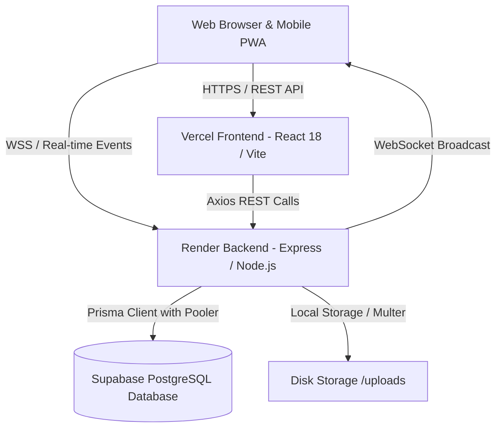
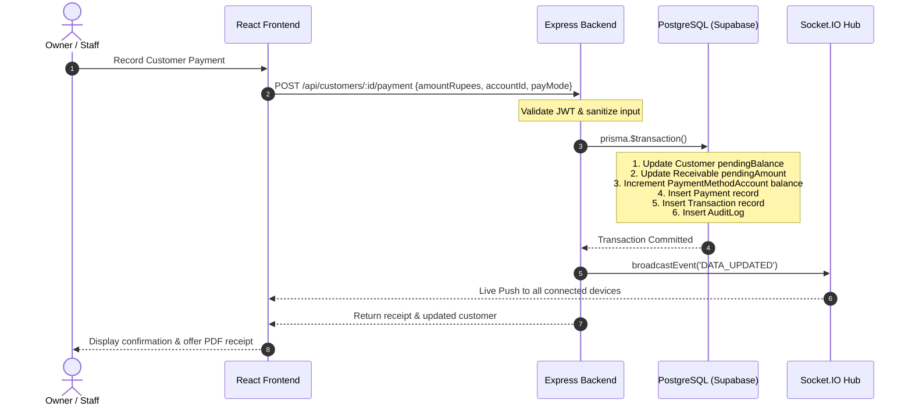

# Current System Architecture – SVE System Overview
**Version**: 1.0 Current State  
**Target Evolution**: SVE 2.0 Unified Platform  

---

## 1. System Context & Component Architecture

---

## 2. Layered Architecture

### 2.1 Presentation Layer (Frontend)
- **Framework**: React 18 with TypeScript.
- **Styling**: Tailwind CSS with custom brand colors (`brand`, `navy`).
- **State Management**:
  - `AuthContext`: Manages logged-in user credentials and JWT token in `localStorage`.
  - `SocketContext`: Maintains live WebSocket connection, auto-reconnects, and triggers silent data refetches across active pages upon `DATA_UPDATED` events.
- **Routing**: `react-router-dom` v7 with role-guarded routes (`ProtectedRoute`).
- **PWA Capabilities**: Service worker v4 with network-first strategy, dynamic update prompt, offline fallback for UI shell.

### 2.2 Application & Business Logic Layer (Backend)
- **Runtime**: Node.js with Express.js and TypeScript (`tsx`).
- **Security & Middleware**:
  - `helmet`: HTTP header security.
  - `cors`: Allowed origins for local dev and Vercel domains (`svesve-*.vercel.app`).
  - `express-rate-limit`: Brute-force mitigation.
  - `authenticateToken`: Verifies JWT bearer tokens.
  - `requireRoles`: Enforces role-based permissions (`OWNER`, `MANAGER`, `STAFF`).
  - `uploadMiddleware`: Multer file upload handling for invoice attachments and receipts.
- **WebSocket Gateway**: `socket.io` server broadcasting mutations (`transaction_created`, `customer_updated`, `dealer_updated`, `DATA_UPDATED`).

### 2.3 Data Access Layer & Persistence
- **ORM**: Prisma ORM with typed client.
- **Database Engine**: PostgreSQL on Supabase.
- **Connection Strategy**:
  - `DATABASE_URL`: Port 6543 connection pooler with `pgbouncer=true`.
  - `DIRECT_URL`: Port 5432 direct connection for schema updates and migrations.
- **Transaction Safety**: Prisma `$transaction` API used for atomic balance updates (e.g., customer payment atomically debits receivable, decrements customer pending balance, increments account balance, creates payment record, and logs audit).

---

## 3. Financial Transaction Lifecycle (Current State)

---

## 4. Current Limitations & Upgrade Vectors

1. **Monolithic Business Boundary**:
   The current schema groups all cash, bank accounts, expenses, and loans into the shop domain. There is no isolation between personal household finances and store operations.
2. **Ledger Granularity**:
   Transactions are stored as single records (`type: INCOME | EXPENSE | TRANSFER`) with account links. While balances are maintained, formal double-entry accounting (Debit Account, Credit Account, General Ledger, Trial Balance) is needed to satisfy audit and multi-entity reporting requirements.
3. **Module Gaps**:
   - **Insurance**: Basic schema exists; needs full policy lifecycle, personal/family categories, 14-policy capacity, and payment tracking.
   - **Chit Funds**: Completely absent in current version.
   - **Personal Income & Daily Budgeting**: Missing dedicated module.
   - **Multi-Scope Dashboard**: Current dashboard only shows shop metrics.
